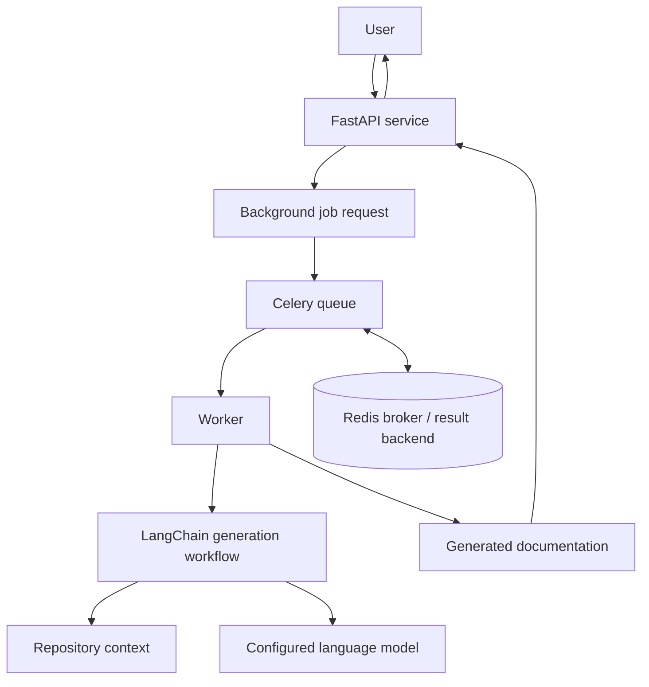

# AutoDoc AI — Code to Clarity

> Team-built AI-assisted documentation platform. The description below reflects the current portfolio project record; verify individual ownership and implementation details before presenting them as personal contributions.

## Problem and goal

Software repositories contain implementation details that are difficult for a new contributor to discover quickly. AutoDoc AI explores a workflow that turns repository context into structured technical documentation, such as README content, API documentation and architecture explanations.

## Documented technology stack

- **FastAPI** — HTTP API layer.
- **LangChain** — orchestration of the language-model workflow.
- **Celery and Redis** — background task processing and queue infrastructure.

The stack list describes the project, not an assertion that every component was independently designed or implemented by one contributor.

## Conceptual architecture

This is a conceptual architecture based on the technologies documented in the project summary. Confirm the actual deployed topology, model provider, data flow and persistence choices in the source before treating it as an implementation diagram.

## Engineering questions worth documenting

A strong technical walkthrough should explain:

1. How repository files are selected, filtered and chunked.
2. How prompts preserve source context and avoid unsupported claims.
3. How generated documentation is checked against repository evidence.
4. How long-running jobs expose status, retries, timeouts and failure states.
5. How repository credentials and user-provided source code are protected.
6. How token usage, latency and output quality are measured.

## Evaluation plan

Do not publish invented accuracy, latency or cost numbers. Build a small, repeatable evaluation set of repositories and record:

- factual correctness against source files;
- coverage of important modules and public APIs;
- unsupported-claim rate;
- output completeness and readability;
- median and p95 generation time;
- token usage and estimated cost;
- task failure and retry rates.

## Limitations and next steps

- Add source citations or file/line references to generated claims.
- Add prompt-injection and untrusted-repository-content tests.
- Add rate limiting, quotas and secure secret management.
- Add deterministic API and worker tests.
- Add observability for queue depth, retries, failures and latency.
- Document the team's division of work accurately.

## Source

[GitHub repository](https://github.com/Muneeb-PT/AutoDoc-AI)

## Interface evidence

The project repository includes these interface screenshots. They are linked from the source repository so the portfolio does not duplicate binary assets.

### Sign-in screen

### Main application screen

These screenshots document the interface only; they are not evidence of model accuracy, production usage or service uptime.
