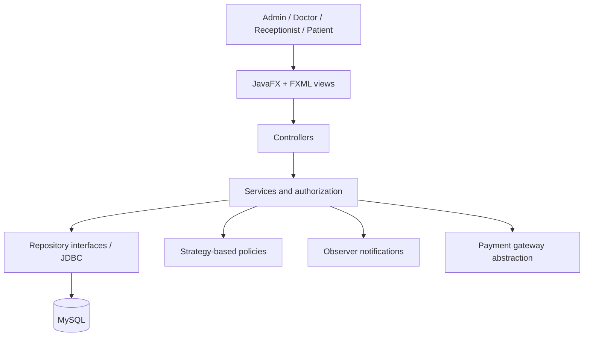

# MediNexus — Smart Hospital Management System

> Academic desktop application built with Java, JavaFX/FXML, JDBC and MySQL. This case study describes the implemented project scope; it is not a claim that the software is certified for clinical or production hospital use.

## Problem and scope

MediNexus explores how a desktop application can bring several hospital-administration workflows into one role-aware system. The application models four user roles: administrator, doctor, receptionist and patient. Its scope includes appointment handling, patient and medical records, medicine inventory, billing/payment flows, identity-verification workflows and notifications.

## Architecture

The codebase is organised around focused packages:

- `config`: database and application configuration.
- `model`: domain objects.
- `controller` and `view`: JavaFX presentation and interaction.
- `repository`: persistence boundaries and JDBC access.
- `service`: application-level workflows and business rules.
- `strategy`: interchangeable prioritisation/payment behaviours.
- `observer`: notification/event subscribers.
- `navigation` and `util`: navigation and shared helpers.

### High-level flow

The diagram is a conceptual view of the documented package responsibilities, not a generated runtime trace.

## Engineering decisions

### Role-aware access

The application distinguishes four roles and routes their workflows through authorization logic. This keeps role checks in the application layer rather than relying only on hiding interface controls. A production deployment would still need a dedicated security review, least-privilege database credentials, secure session handling and audit-log retention policies.

### Appointment prioritisation

Appointment priority considers urgency categories (emergency, chronic and routine) and a waiting-time bonus. Keeping prioritisation behind a strategy boundary makes the policy easier to test and change than embedding it directly in a screen controller. Any clinical triage decision must remain with qualified staff; this academic feature is not a medical decision system.

### Persistence

Repositories isolate JDBC/MySQL operations from the UI. The connection configuration supports environment/system-property overrides so deployments can supply database settings without hard-coding credentials in source.

### Extensible workflows

The project uses strategy-style policies for variable behaviour and observer-style notification handling. Payment is represented through a gateway abstraction; the included demo gateway must not be represented as a real payment processor.

## Verification and release status

The project has an automated test suite and a packaged Windows installer. Earlier local development validation reported 222 tests with zero failures; rerun the current test suite before quoting that count as a current release result. The installer was tested in an isolated Windows installation environment, but broader hardware/OS/database compatibility testing remains outstanding.

## Known limitations and next steps

- Validate installation and database setup on clean machines and document supported MySQL versions.
- Add integration tests against a disposable MySQL instance.
- Review authorization at every service/repository boundary.
- Add structured application logging and actionable error handling.
- Replace demo integrations with properly secured providers before any real deployment.
- Conduct accessibility, privacy, backup/restore and security reviews.
- Do not use real patient data in demonstrations.

## Visual evidence\n\nThe repository currently contains branding assets but no verified screenshots of the running JavaFX interface. A real application screenshot should be captured from the packaged build and added here before presenting the project with visual UI evidence. The background and logo assets are intentionally not presented as application screenshots.\n\n## Source

[GitHub repository](https://github.com/Muneeb-PT/MediNexus)
